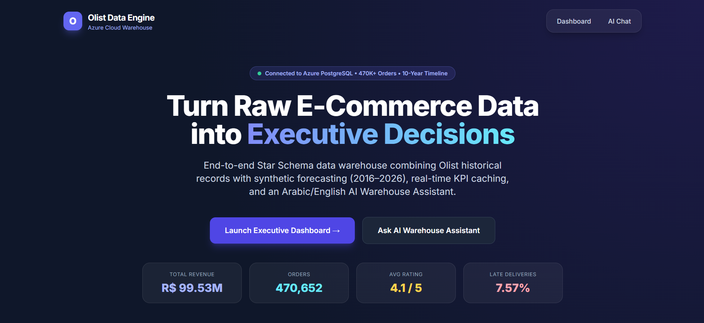
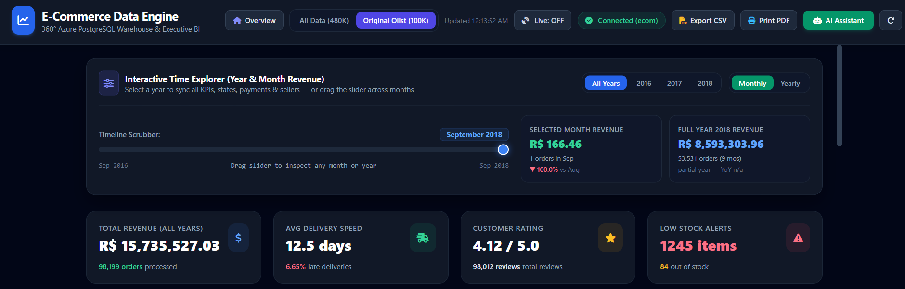
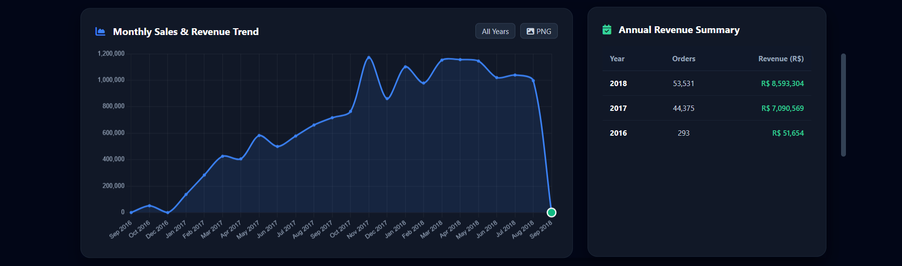
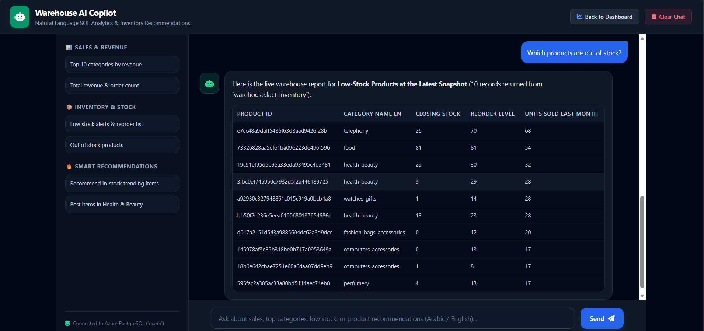
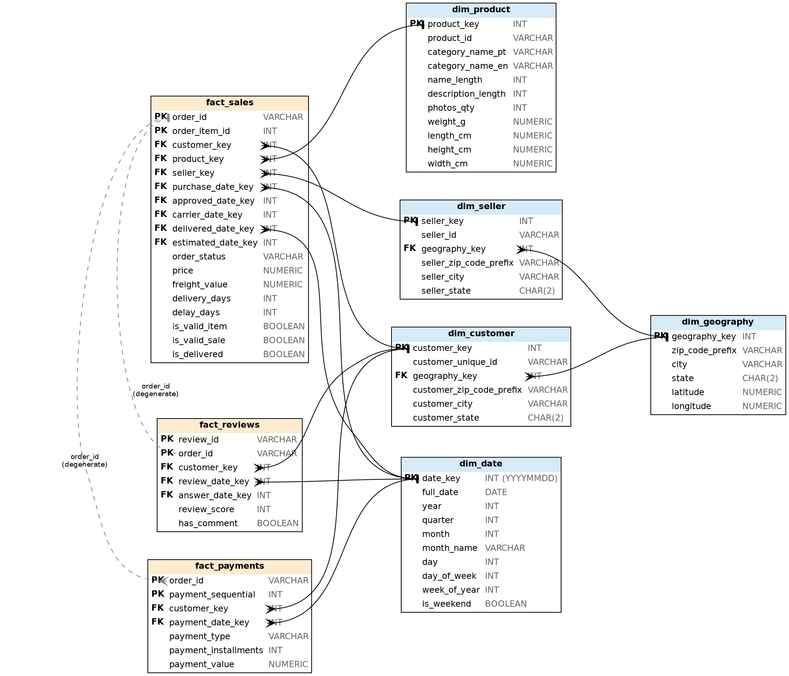

<div align="center">

# Olist E-Commerce Data Warehouse & AI Analytics Assistant

## 🚀 [EXPLORE THE LIVE DEMO](https://ecommerce-api-v2.icycliff-7a2355f7.francecentral.azurecontainerapps.io/)

**An End-to-End Data Engineering Project**

</div>

An end-to-end data engineering project built on the [Olist Brazilian E-Commerce dataset](https://www.kaggle.com/datasets/olistbr/brazilian-ecommerce). It ingests raw CSVs, cleans them, models them as a star schema in PostgreSQL, validates data quality at every layer, and serves the results through a FastAPI backend with an executive dashboard and an AI analytics assistant.

## Table of Contents

- [Features](#features)
- [Screenshots](#screenshots)
- [Tech Stack](#tech-stack)
- [Architecture](#architecture)
- [Project Structure](#project-structure)
- [Getting Started](#getting-started)
- [Data](#data)
- [Data Pipeline](#data-pipeline)
- [Warehouse Design](#warehouse-design)
- [Analytical Queries](#analytical-queries)
- [Data Quality](#data-quality)
- [Synthetic Data](#synthetic-data)
- [Web Application](#web-application)
- [Live Demo](#live-demo)
- [Deployment (Azure Container Apps)](#deployment-azure-container-apps)

---

## Features

- **Layered warehouse:** `raw` → `staging` → `warehouse` (Gold star schema), with a separate `dq` schema for quality results.
- **Automated data quality:** 38 profiling checks on raw data and 69 tests on the Gold layer, with generated Markdown reports.
- **Star schema:** 5 dimensions and 3 fact tables, plus a synthetic inventory fact table.
- **21 analytical queries** covering sales, delivery, reviews, payments, geography, customers, and inventory.
- **Executive dashboard:** KPIs, an interactive time explorer, revenue trend, top states, categories and sellers, payment mix, delivery and inventory insights, year filtering, data-scope switching (all data or original Olist only), and CSV / PDF export.
- **AI analytics assistant:** answers business questions in natural language (English and Arabic keywords) by routing them to approved SQL reports.
- **Performance:** connection pooling, a combined single-round-trip KPI query, and a one-hour in-memory cache with background pre-warming.
- **One-command pipeline:** run every stage end to end with `scripts/run_pipeline.py`.

## Screenshots

### Landing Page



### Executive Dashboard






### AI Analytics Assistant



### Warehouse ERD



## Tech Stack

| Area | Tools |
|---|---|
| Database | PostgreSQL (Docker locally, Azure Database for PostgreSQL for hosted data) |
| Pipeline | Python, SQL |
| Backend | FastAPI, Uvicorn, `psycopg2` `ThreadedConnectionPool` |
| Frontend | HTML, Tailwind CSS, Chart.js, vanilla JavaScript |
| Infrastructure | Docker, Docker Compose, Azure Container Apps, GitHub Actions, GHCR |

## Architecture

```text
Olist CSVs ──► raw ──► staging ──► warehouse (star schema) ──► FastAPI ──► Dashboard / AI Assistant
                │          │              │
                └──────────┴──────────────┴──► dq (quality checks & reports)
```

| Layer | Purpose |
|---|---|
| `raw` | Data loaded as-is from the source files |
| `staging` | Typed and cleaned data |
| `warehouse` | Gold layer: star schema used by analytics |
| `dq` | Column profiles and data quality check results |

## Project Structure

```text
ecommerce-data-engine/
├── api/                # FastAPI app (main.py, routers: analytics, chat, health)
├── data/raw/           # Olist CSVs (not in Git, see Data section)
├── docs/               # Profiling report, warehouse DQ report, ERD, screenshots
├── ingestion/          # Raw loader
├── profiling/          # Raw data profiling and quality checks
├── scripts/            # Run pipeline, simulate orders, run queries, test connection
├── sql/
│   ├── init/           # Schemas (run automatically by Docker)
│   ├── staging/        # Staging layer SQL
│   └── warehouse/      # DDL, load scripts, analytical queries, inventory
├── staging/            # Staging runner and validation
├── warehouse/          # DDL runner, ETL, inventory generation, DQ checks
├── index.html          # Executive dashboard
├── chat.html           # AI analytics assistant
├── landing.html        # Landing page (entry point of the site)
├── enhance.js          # Shared UX layer for the three pages
├── Dockerfile
├── docker-compose.yml
├── .env.example
└── requirements.txt
```

## Getting Started

### Prerequisites

- Python 3.13
- Docker (only for the local database)
- The Olist CSV files (see [Data](#data))

### 1. Clone and Install

```bash
git clone https://github.com/mohamedahmed005/ecommerce-data-engine.git
cd ecommerce-data-engine

python -m venv .venv && source .venv/bin/activate  # Windows: .venv\Scripts\activate
pip install -r requirements.txt
```

### 2. Configure the Environment

```bash
cp .env.example .env     # Windows: copy .env.example .env
```

Set the connection variables in `.env`:

| Variable | Description |
|---|---|
| `POSTGRES_HOST` | `localhost` for Docker, or the Azure PostgreSQL server FQDN |
| `POSTGRES_PORT` | `5432` |
| `POSTGRES_DB` | Database name (`ecom`) |
| `POSTGRES_USER` | Database user |
| `POSTGRES_PASSWORD` | Database password |
| `PGSSLMODE` | `require` for Azure, omit or `prefer` locally |

> `.env` is local only and is never committed. Copy it from `.env.example` on every machine.

### 3. Choose a Database

**Option A: Local Database (Docker)**

```bash
docker compose up -d
docker compose ps                  # ecom_postgres should be "healthy"
python scripts/test_connection.py  # prints the Postgres version
```

Then build the warehouse with the [pipeline](#data-pipeline).

To reset the local database completely (deletes all data):

```bash
docker compose down -v
```

**Option B: Existing Azure PostgreSQL Database**

The warehouse data is already loaded in an Azure PostgreSQL database named `ecom`. Point your `.env` at it and skip the pipeline.

**Important:** Do not run Docker database initialization or rebuild steps against the hosted database unless you explicitly intend to modify it.

### 4. Run the App Locally

```bash
python -m uvicorn api.main:app --host 127.0.0.1 --port 8000 --reload
```

| Page | URL |
|---|---|
| Landing page | [http://localhost:8000/](http://localhost:8000/) |
| Executive dashboard | [http://localhost:8000/dashboard](http://localhost:8000/dashboard) |
| AI assistant | [http://localhost:8000/chat](http://localhost:8000/chat) |
| API docs | [http://localhost:8000/docs](http://localhost:8000/docs) |
| Health check | [http://localhost:8000/api/health](http://localhost:8000/api/health) |

## Data

The CSVs are not committed. Download the Olist dataset from [Kaggle](https://www.kaggle.com/datasets/olistbr/brazilian-ecommerce) and place the 9 files in `data/raw/`.

| Table | Expected rows |
|---|---:|
| customers | 99,441 |
| geolocation | 1,000,163 |
| order_items | 112,650 |
| order_payments | 103,886 |
| order_reviews | 99,224 |
| orders | 99,441 |
| products | 32,951 |
| sellers | 3,095 |
| product_category_translation | 71 |

If your counts differ, check the CSVs before moving on.

## Data Pipeline

### Run Everything with One Command

```bash
python scripts/run_pipeline.py                         # Standard run (original Olist data only)
python scripts/run_pipeline.py --docker                # Check/start Docker first
python scripts/run_pipeline.py --replace-demo 380000 --batch-size 5000
python scripts/run_pipeline.py --from etl              # Resume from a stage
python scripts/run_pipeline.py --only dq               # Run a single stage
```

### Run Stage by Stage

| Step | Command | What it does |
|---|---|---|
| 1. Ingestion | `python ingestion/ingest_olist.py` | Loads the 9 CSVs into `raw` |
| 2. Profiling | `python profiling/profile_raw.py` | Writes column stats to `dq.column_profile`, 38 checks to `dq.check_results`, and `docs/profiling_report.md` |
| 3. Staging | `python staging/run_staging.py` | Builds typed, cleaned tables in `staging` |
| 4. Warehouse DDL | `python warehouse/run_ddl.py` | Creates the empty star schema (safe to re-run) |
| 5. Warehouse ETL | `python warehouse/run_etl.py` | Loads dimensions and facts, then validates |
| 6. Inventory | `python warehouse/generate_inventory.py` | Generates synthetic `fact_inventory` |
| 7. Queries | `python scripts/run_queries.py` | Runs the analytical queries |
| 8. DQ checks | `python warehouse/run_dq_checks.py` | Runs 69 Gold-layer tests and writes `docs/warehouse_dq_report.md` |

Profiling checks are grouped by uniqueness, integrity, completeness, validity, and consistency. To add one, append a tuple to `CHECKS` in `profiling/profile_raw.py`.

## Warehouse Design

Star schema ERD and data dictionary: `docs/erd/warehouse_erd.md` (diagram: `docs/erd/warehouse_erd.png`).

| Table | Type | Grain | Primary key |
|---|---|---|---|
| dim_date | dimension | One calendar day | date_key (YYYYMMDD) |
| dim_geography | dimension | One zip-code prefix | geography_key |
| dim_customer | dimension | One real customer (`customer_unique_id`) | customer_key |
| dim_product | dimension | One product | product_key |
| dim_seller | dimension | One seller | seller_key |
| fact_sales | fact | One order item | (order_id, order_item_id) |
| fact_payments | fact | One payment row of an order | (order_id, payment_sequential) |
| fact_reviews | fact | One review | (review_id, order_id) |
| fact_inventory | fact (synthetic) | One product per month | (product_key, snapshot_date_key) |

**Design Notes**

- Every dimension has a surrogate key; the natural key is kept as a `UNIQUE` attribute.
- Each dimension (except `dim_date`) has an **Unknown** member with key `-1`. A fact row that cannot resolve a key points to it instead of being dropped.
- `fact_sales` has five role-playing date keys (purchase, approved, carrier, delivered, estimated). They are `NULL` when the event never happened.
- `fact_sales` carries the quality flags `is_valid_item`, `is_valid_sale`, `is_delivered`, and `is_synthetic`. Suspicious rows are flagged, never deleted.
- `order_id` is a degenerate dimension: `fact_payments` and `fact_reviews` link to `fact_sales` through `order_id` only, with no enforced FK.

**ETL Rules**

- A date that does not exist (for example, an order never delivered) stays `NULL`.
- `dim_customer` keeps one row per `customer_unique_id`, with the address of the customer's most recent order.
- `dim_geography` contains every zip in `staging.geolocation`, plus zips used by customers or sellers that geolocation lacks (coordinates `NULL`).
- `delivery_days` = delivered date − purchase date. `delay_days` = delivered date − estimated date (positive = late). Both use calendar dates.
- `is_valid_item` = `price > 0` and `freight_value >= 0` and all keys resolved. `is_valid_sale` = `is_valid_item` and status not `canceled`/`unavailable`. `is_delivered` = status `delivered` and a delivered date exists.

**Synthetic Inventory (`fact_inventory`)**

Olist does not track inventory, so it is generated from actual monthly sales via `sql/warehouse/06_inventory.sql`.

| Column | Meaning |
|---|---|
| `product_key`, `snapshot_date_key` | Keys to `dim_product` and `dim_date` (last day of the month) |
| `opening_stock` | Stock at the start of the month |
| `units_received` | Simulated restock shipments |
| `units_sold` | Real valid-sale items of the product in that month |
| `closing_stock` | `opening_stock + units_received - units_sold` |
| `reorder_level` | Simulated reorder threshold |
| `is_low_stock` | `closing_stock <= reorder_level` |

## Analytical Queries

All queries live in `sql/warehouse/05_analytical_queries.sql` (Gold layer) and are divided into three sections:

- **Section A (1–5):** Olist reference queries (`is_synthetic = FALSE`), used as deterministic benchmarks.
- **Section B (6–17):** Full-timeline analytics (2016–2026, original plus demo data) for the dashboard and AI assistant.
- **Section C (18–21):** Inventory analytics.

| # | Query | Section | What it measures |
|---:|---|:---:|---|
| 1 | Reference: Monthly Sales Performance | A | Monthly revenue and orders |
| 2 | Reference: Delivery Performance | A | Delivery delays, on-time rate |
| 3 | Reference: Customer Review Analysis | A | Review score breakdown |
| 4 | Reference: Payment Analysis | A | Payment types and volume |
| 5 | Reference: Sales by Customer State | A | Geographic distribution |
| 6 | Monthly Sales Performance | B | Continuous revenue and order trend |
| 7 | Average Order Value and Monthly Growth | B | Monthly AOV and MoM growth |
| 8 | Top 10 Product Categories | B | Revenue and market share |
| 9 | Top 10 Products by Revenue | B | Best sellers across all years |
| 10 | Top 10 Sellers by Revenue | B | Top merchants by sales |
| 11 | Delivery Performance | B | Delivery speed and late rates |
| 12 | Delivery Delay vs Customer Reviews | B | Satisfaction impact of delays |
| 13 | Customer Review Analysis | B | Rating distribution |
| 14 | Payment Analysis | B | Payment method shares and values |
| 15 | Sales by Customer State | B | Geographic sales and revenue share |
| 16 | Customer Spending & Repeat Orders | B | Retention and repeat purchases |
| 17 | Order Status Breakdown by Month | B | Cancellation and fulfillment rates |
| 18 | Low-Stock Products | C | SKUs at or below reorder threshold |
| 19 | Monthly Inventory Health | C | Stock-out and low-stock rates |
| 20 | Stock Coverage by Category | C | Months of cover per category |
| 21 | Best-Selling Products vs Current Stock | C | Top products compared to closing stock |

Run them with:

```bash
python scripts/run_queries.py
```

## Data Quality

`python warehouse/run_dq_checks.py` runs 69 tests on the warehouse schema, logs results to `dq.warehouse_check_results`, and writes `docs/warehouse_dq_report.md`. This is independent from the validation inside `run_etl.py`.

| Category | What it checks |
|---|---|
| Reconciliation | Row counts and sums (`price`, `freight_value`, `payment_value`) match `staging` |
| Uniqueness | No duplicate primary or composite keys |
| Referential integrity | All foreign keys resolve to dimension rows |
| Unknown members | No fact row unexpectedly defaults to `-1` |
| Completeness | Required measures, date keys, and statuses have no unexpected `NULL`s |
| Validity | No negative prices, ratings outside 1–5, or delivery date paradoxes |
| Consistency | Quality flags align with timestamps and statuses |
| Olist reference results | Known baseline metrics on original records (for example, 112,101 valid sales) |
| Synthetic demo data | `is_synthetic` flag is consistent across sales, payments, and reviews |
| Inventory (synthetic) | Stock continuity, movement math, and reorder levels |

## Synthetic Data

Optional. Adds realistic demo orders to the `raw` layer from November 2018 to September 2026, continuing where the original Olist data ends, so the dashboard and assistant have a longer timeline.

```bash
python scripts/simulate_db_orders.py --orders 380000 --batch-size 5000           # Add demo orders
python scripts/simulate_db_orders.py --orders 380000 --replace --batch-size 5000 # Replace with a fresh batch
python scripts/simulate_db_orders.py --remove                                    # Back to original Olist only
```

After generating or removing demo rows, always rebuild the downstream layers:

```bash
python staging/run_staging.py
python warehouse/run_etl.py
python warehouse/generate_inventory.py
```

**Characteristics**

- Covers 2018-11-01 to 2026-09-30 (about 95 months) with gradual growth and seasonal peaks such as Black Friday and the holidays.
- Uses real product and seller pairs from the original data, with slight price and freight variation, realistic review scores, delivery lead times (about 12.5 days on average), and a 2% cancellation rate.
- Inserts in configurable batches inside a single atomic transaction.
- Original Olist rows are never modified. Synthetic rows carry `_source_file = 'synthetic_demo'` in `raw` and `is_synthetic = TRUE` in `warehouse`. Queries 1–5 and the DQ reference checks use original records only.

## Web Application

### Backend

- FastAPI app with entry point `api.main:app`.
- PostgreSQL access through `ThreadedConnectionPool` (`minconn=2`, `maxconn=10`).
- KPI and dashboard responses are cached in memory for one hour. A background thread pre-warms the full-timeline cache by year, then the original Olist summary.
- A combined CTE query returns sales, delivery, and review KPIs in one database round trip.

### Endpoints

| Endpoint | Description |
|---|---|
| `/api/analytics/dashboard` | Dashboard data. Supports `year` and `include_synthetic` |
| `/api/analytics/kpis` | Executive KPIs. Supports `year` and `include_synthetic` |
| `/api/health` | Database connection check |
| `/docs` | Interactive API documentation |

`include_synthetic` selects the data scope: original Olist data only, or the full timeline (Olist plus synthetic data).

### Pages

| Page | File | Description |
|---|---|---|
| Landing | `landing.html` | Entry point of the site, with live headline KPIs |
| Dashboard | `index.html` | Executive dashboard |
| Assistant | `chat.html` | AI analytics assistant |

`enhance.js` is a shared UX layer loaded by all three pages. It wraps the existing page functions without changing markup or API logic, and every feature is guarded so a failure never breaks the page.

- **Dashboard:** loading skeletons, animated KPI counters, month-over-month and year-over-year deltas, optional 60-second live refresh, revenue chart PNG download, sortable and searchable tables, keyboard shortcuts (`←` `→` to step through months, `r` to reload), and automatic recovery when the API comes back online. The selected year and data scope are remembered.
- **Landing:** headline KPI strip and scroll-reveal animations.
- **Assistant:** command history (`↑` `↓`), `/` to focus the input, automatic text direction, copy buttons, timestamps, scroll-to-bottom button, mobile quick-prompt chips, chat export to `.txt`, and chat persistence between visits.

### AI Analytics Assistant

`api/routers/chat.py` routes each question to an approved report using intent classification and supported keywords in English and Arabic.

**Supported Topics**

- Revenue, monthly sales, and average order value
- Top product categories and sellers
- Delivery times and delays, customer reviews, and payment methods
- Low-stock and reorder reports (the executive inventory summary also reports out-of-stock counts)
- Trending product recommendations with healthy stock, optionally filtered by category such as `health_beauty`

**Example Questions**

- `What is the total revenue and order count?`
- `Top 10 categories by revenue`
- `Show low stock products that need reorder`
- `Recommend trending products in stock`
- `Recommend products in health_beauty category`

## Live Demo

The project is deployed on Microsoft Azure and publicly accessible through the following links.

| Component | Live URL |
|---|---|
| Landing Page | [Open Website](https://ecommerce-api-v2.icycliff-7a2355f7.francecentral.azurecontainerapps.io/) |
| Executive Dashboard | [Open Dashboard](https://ecommerce-api-v2.icycliff-7a2355f7.francecentral.azurecontainerapps.io/dashboard) |
| AI Analytics Assistant | [Open Assistant](https://ecommerce-api-v2.icycliff-7a2355f7.francecentral.azurecontainerapps.io/chat) |
| API Documentation | [Swagger UI](https://ecommerce-api-v2.icycliff-7a2355f7.francecentral.azurecontainerapps.io/docs) |
| API Health Check | [Check API Status](https://ecommerce-api-v2.icycliff-7a2355f7.francecentral.azurecontainerapps.io/api/health) |

## Deployment (Azure Container Apps)

The application is deployed using **Azure Container Apps**, with an existing **Azure Database for PostgreSQL Flexible Server** hosting the warehouse data.

### Cloud Infrastructure

| Component | Technology |
|---|---|
| Application Hosting | Azure Container Apps |
| Container Registry | GitHub Container Registry (GHCR) |
| Database Hosting | Azure Database for PostgreSQL Flexible Server |
| Backend | FastAPI + Uvicorn |
| Container Port | 8080 |
| Database | PostgreSQL (`ecom`) |

### Docker Image

The application image is published to GitHub Container Registry:

```text
ghcr.io/mohamedahmed005/ecommerce-data-engine:latest
```

Version-specific images are also published using the full Git commit SHA.

### CI/CD Pipeline

GitHub Actions automates Docker image building and publishing whenever changes are pushed to the `main` branch.

The workflow performs the following steps:

1. Checks out the latest repository code.
2. Sets up Docker Buildx.
3. Authenticates with GitHub Container Registry.
4. Builds the Docker image using the project's Dockerfile.
5. Publishes two image tags:
   - `latest`
   - The full Git commit SHA.

### Database Configuration

The application connects to the existing Azure PostgreSQL database through environment variables configured in Azure Container Apps.

| Variable | Description |
|---|---|
| `POSTGRES_HOST` | Azure PostgreSQL server hostname |
| `POSTGRES_PORT` | `5432` |
| `POSTGRES_DB` | `ecom` |
| `POSTGRES_USER` | Database username |
| `POSTGRES_PASSWORD` | Stored securely in Azure |
| `PGSSLMODE` | `require` |

Database credentials are configured securely in Azure and are never committed to the repository.

### Deployment Verification

The following endpoints are available for checking the deployed application:

- `/` — Landing page
- `/dashboard` — Executive dashboard
- `/chat` — AI analytics assistant
- `/docs` — Interactive API documentation
- `/api/health` — API and database health status