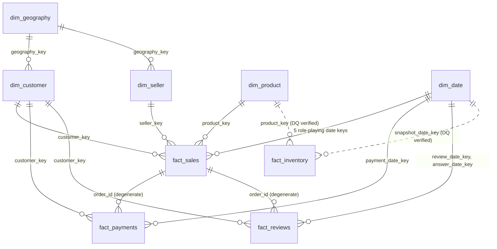

# 04. Data Warehouse Design

## Star Schema Diagram




---

## Dimensional Modeling Principles

The `warehouse` (Gold) layer follows **Kimball Star Schema** conventions tailored for PostgreSQL analytical workloads:

1. **Surrogate Keys on Every Dimension:** All dimensions use integer surrogate keys (`GENERATED BY DEFAULT AS IDENTITY`, or `YYYYMMDD` for `dim_date`), while source natural keys are retained as `UNIQUE` attributes.
2. **Unknown Member Pattern (`key = -1`):** `dim_geography`, `dim_customer`, `dim_product`, and `dim_seller` each include a pre-seeded `-1` (`'unknown'`) row. If a fact lookup ever fails to resolve a natural key, the row maps to `-1` instead of failing the ETL or silently disappearing.
3. **True Customer Consolidation (`dim_customer`):** In raw Olist data, `customer_id` is regenerated per order. `dim_customer` consolidates on `customer_unique_id` using the address from the customer's most recent order, enabling accurate repeat-purchase and retention analysis.
4. **Role-Playing Date Dimension (`dim_date`):** `fact_sales` references `dim_date` five times (`purchase_date_key`, `approved_date_key`, `carrier_date_key`, `delivered_date_key`, `estimated_date_key`), and `fact_reviews` references it twice (`review_date_key`, `answer_date_key`). Unoccurred events remain `NULL`.
5. **Degenerate Dimension (`order_id`):** `fact_sales`, `fact_payments`, and `fact_reviews` share `order_id` without enforced cross-fact foreign keys because an order can contain multiple items and multiple payment installments (many-to-many relationship).
6. **Non-Destructive Quality & Lineage Flags:** `fact_sales` stores `is_valid_item`, `is_valid_sale`, `is_delivered`, and `is_synthetic` (`fact_payments` and `fact_reviews` also store `is_synthetic`), allowing consumers to switch between full-timeline analytics and deterministic Olist benchmarks.

---

## Data Dictionary — Dimensions

### `warehouse.dim_date`
- **Grain:** One calendar day covering the full contiguous date range of orders and reviews.
- **Primary Key:** `date_key` (`integer`, format `YYYYMMDD`, e.g., `20180131`).

| Column | Type | Constraints / Notes |
|---|---|---|
| `date_key` | `integer` | `PRIMARY KEY` (`YYYYMMDD`) |
| `full_date` | `date` | `NOT NULL UNIQUE` |
| `year` | `integer` | `NOT NULL` |
| `quarter` | `integer` | `NOT NULL CHECK (quarter BETWEEN 1 AND 4)` |
| `month` | `integer` | `NOT NULL CHECK (month BETWEEN 1 AND 12)` |
| `month_name` | `varchar(20)` | `NOT NULL` (trimmed English month name) |
| `day` | `integer` | `NOT NULL CHECK (day BETWEEN 1 AND 31)` |
| `day_of_week` | `integer` | `NOT NULL CHECK (day_of_week BETWEEN 1 AND 7)` (ISO: 1 = Monday) |
| `week_of_year` | `integer` | `NOT NULL CHECK (week_of_year BETWEEN 1 AND 53)` |
| `is_weekend` | `boolean` | `NOT NULL` (`TRUE` when `day_of_week IN (6, 7)`) |

### `warehouse.dim_geography`
- **Grain:** One Brazilian zip-code prefix (from `staging.geolocation` plus customer/seller zip prefixes missing from geolocation).
- **Unknown Member:** `geography_key = -1`, `zip_code_prefix = 'unknown'`.

| Column | Type | Constraints / Notes |
|---|---|---|
| `geography_key` | `integer` | `GENERATED BY DEFAULT AS IDENTITY PRIMARY KEY` |
| `zip_code_prefix` | `varchar(10)` | `NOT NULL UNIQUE` |
| `city` | `varchar(100)` | Lowercase, unaccented modal city name |
| `state` | `char(2)` | Uppercase 2-letter Brazilian UF state code |
| `latitude` | `numeric(10,6)` | Averaged within Brazil bounds (`NULL` for fallback zips) |
| `longitude` | `numeric(10,6)` | Averaged within Brazil bounds (`NULL` for fallback zips) |

### `warehouse.dim_customer`
- **Grain:** One real customer (`customer_unique_id`), retaining the address from their most recent order.
- **Indexes:** Primary key on `customer_key`; index on `geography_key`.

| Column | Type | Constraints / Notes |
|---|---|---|
| `customer_key` | `integer` | `GENERATED BY DEFAULT AS IDENTITY PRIMARY KEY` (`-1` = Unknown) |
| `customer_unique_id` | `varchar(50)` | `NOT NULL UNIQUE` |
| `geography_key` | `integer` | `REFERENCES warehouse.dim_geography(geography_key)` |
| `customer_zip_code_prefix` | `varchar(10)` | Most recent zip prefix |
| `customer_city` | `varchar(100)` | Normalized city name |
| `customer_state` | `char(2)` | 2-letter state code |

### `warehouse.dim_product`
- **Grain:** One product SKU (`product_id`).

| Column | Type | Constraints / Notes |
|---|---|---|
| `product_key` | `integer` | `GENERATED BY DEFAULT AS IDENTITY PRIMARY KEY` (`-1` = Unknown) |
| `product_id` | `varchar(50)` | `NOT NULL UNIQUE` |
| `category_name_pt` | `varchar(100)` | Portuguese category (`'unknown'` if NULL in source) |
| `category_name_en` | `varchar(100)` | English category (71 Olist + 2 manual translations) |
| `name_length` | `integer` | Character count of product name |
| `description_length` | `integer` | Character count of product description |
| `photos_qty` | `integer` | Number of product listing photos |
| `weight_g` | `numeric` | Product weight in grams (`0` coerced to `NULL` in staging) |
| `length_cm`, `height_cm`, `width_cm` | `numeric` | Package dimensions in centimeters |

### `warehouse.dim_seller`
- **Grain:** One merchant seller (`seller_id`).
- **Indexes:** Primary key on `seller_key`; index on `geography_key`.

| Column | Type | Constraints / Notes |
|---|---|---|
| `seller_key` | `integer` | `GENERATED BY DEFAULT AS IDENTITY PRIMARY KEY` (`-1` = Unknown) |
| `seller_id` | `varchar(50)` | `NOT NULL UNIQUE` |
| `geography_key` | `integer` | `REFERENCES warehouse.dim_geography(geography_key)` |
| `seller_zip_code_prefix` | `varchar(10)` | Seller zip prefix |
| `seller_city` | `varchar(100)` | Normalized seller city |
| `seller_state` | `char(2)` | 2-letter seller state code |

---

## Data Dictionary — Fact Tables

### `warehouse.fact_sales`
- **Grain:** One line item of an order — `PRIMARY KEY (order_id, order_item_id)`.
- **Indexes:** `order_id`, `customer_key`, `product_key`, `seller_key`, `purchase_date_key`.

| Column | Type | Constraints / Derivation |
|---|---|---|
| `order_id`, `order_item_id` | `varchar(50)`, `integer` | Composite Primary Key (`order_id` is degenerate dimension) |
| `customer_key`, `product_key`, `seller_key` | `integer` | `NOT NULL` Foreign Keys to respective dimensions |
| `purchase_date_key`, `approved_date_key`, `carrier_date_key`, `delivered_date_key`, `estimated_date_key` | `integer` | Role-playing Foreign Keys to `dim_date(date_key)` (nullable) |
| `order_status` | `varchar(20)` | `NOT NULL` (e.g., `delivered`, `shipped`, `canceled`, `unavailable`) |
| `price`, `freight_value` | `numeric(10,2)` | Item revenue and shipping fee in BRL (R$) |
| `delivery_days` | `integer` | `delivered_ts::date - purchase_ts::date` (`NULL` if undelivered) |
| `delay_days` | `integer` | `delivered_ts::date - estimated_delivery_ts::date` (`> 0` = late) |
| `is_valid_item` | `boolean` | `price > 0 AND freight_value >= 0` and all 3 dim keys resolved |
| `is_valid_sale` | `boolean` | `is_valid_item AND order_status NOT IN ('canceled', 'unavailable')` |
| `is_delivered` | `boolean` | `order_status = 'delivered' AND delivered_date_key IS NOT NULL` |
| `is_synthetic` | `boolean` | `TRUE` if `raw.orders._source_file = 'synthetic_demo'`, else `FALSE` |

### `warehouse.fact_payments`
- **Grain:** One payment installment/method record of an order — `PRIMARY KEY (order_id, payment_sequential)`.
- **Indexes:** `customer_key`, `payment_date_key`.
- **Columns:** `order_id`, `payment_sequential`, `customer_key` (FK), `payment_date_key` (FK to `dim_date`, based on order purchase date), `payment_type` (`varchar(30)`), `payment_installments` (`integer`, min `1`), `payment_value` (`numeric(10,2)`), `is_synthetic` (`boolean`).

### `warehouse.fact_reviews`
- **Grain:** One deduplicated review per order — `PRIMARY KEY (review_id, order_id)`.
- **Indexes:** `order_id`, `customer_key`.
- **Columns:** `review_id`, `order_id`, `customer_key` (FK), `review_date_key` (FK), `answer_date_key` (FK), `review_score` (`integer CHECK (BETWEEN 1 AND 5)`), `has_comment` (`boolean`), `is_synthetic` (`boolean`).

### `warehouse.fact_inventory` *(Synthetic)*
- **Grain:** One product per month-end snapshot — `PRIMARY KEY (product_key, snapshot_date_key)`.
- **Index:** `idx_fact_inventory_date` on `snapshot_date_key`.
- **Design Note:** Intentionally omits hard database `FOREIGN KEY` constraints so `warehouse/run_etl.py` can truncate and reload dimensions without blocking; referential integrity to `dim_product` and `dim_date` is enforced by `warehouse/run_dq_checks.py`.
- **Columns:** `product_key`, `snapshot_date_key`, `opening_stock`, `units_received` (simulated), `units_sold` (real valid Olist sales), `closing_stock` (`opening_stock + units_received - units_sold`), `reorder_level` (simulated), `is_low_stock` (`closing_stock <= reorder_level`).

---

## Multi-Fact Querying Best Practice

Because `fact_sales` is at the **order-item** grain while `fact_payments` and `fact_reviews` are at the **payment-row** and **review** grains, joining them directly on `order_id` creates a fan-out that double-counts revenue. Always aggregate each fact table to `order_id` in separate CTEs before joining:

```sql
WITH order_sales AS (
    SELECT order_id, SUM(price + freight_value) AS order_revenue
    FROM warehouse.fact_sales
    WHERE is_valid_sale = TRUE
    GROUP BY order_id
),
order_reviews AS (
    SELECT order_id, AVG(review_score) AS avg_score
    FROM warehouse.fact_reviews
    GROUP BY order_id
)
SELECT s.order_id, s.order_revenue, r.avg_score
FROM order_sales s
LEFT JOIN order_reviews r ON s.order_id = r.order_id;
```

---

## Analytical Query Catalog (`sql/warehouse/05_analytical_queries.sql`)

The Gold layer ships with **21 governed analytical queries** parsed dynamically by both `scripts/run_queries.py` and `api/db.py`:

| Section | Query IDs | Scope | Analytics Covered |
|---|---|---|---|
| **Section A** | `1–5` | Original Olist (`is_synthetic = FALSE`) | Reference benchmarks: monthly sales, delivery SLA, reviews, payments, sales by state |
| **Section B** | `6–17` | Full Timeline (`2016–2026`) | Monthly sales, AOV & MoM growth, top 10 categories/products/sellers, delivery SLA, delay vs. reviews, ratings, payments, states, repeat customer retention, order status breakdown |
| **Section C** | `18–21` | Synthetic Inventory (`fact_inventory`) | Low-stock SKUs at latest snapshot, monthly inventory health, stock coverage by category, best-selling products vs. current stock |
