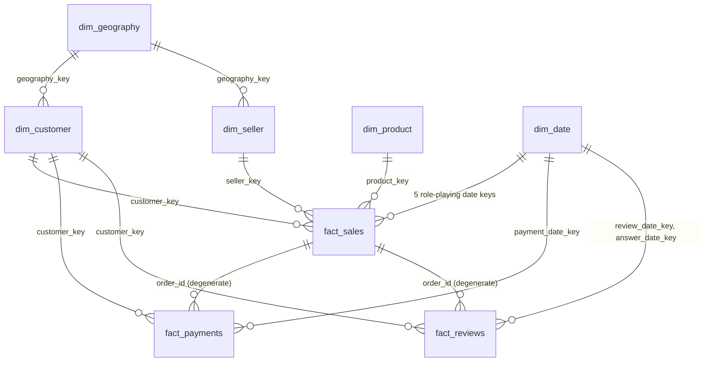

# Warehouse ERD — E-Commerce Data Engine (Olist)

Star schema (Kimball). Blue = dimensions, orange = facts. Diagram: `warehouse_erd.png` / `warehouse_erd.svg`.

## Mermaid version (renders on GitHub / Notion / Mermaid Live)

## Grain

| Table | Grain | Primary key |
|---|---|---|
| fact_sales | one order item | (order_id, order_item_id) |
| fact_payments | one payment row of an order | (order_id, payment_sequential) |
| fact_reviews | one review | (review_id, order_id) |
| dim_customer | one real customer | customer_key (natural: customer_unique_id) |
| dim_product | one product | product_key (natural: product_id) |
| dim_seller | one seller | seller_key (natural: seller_id) |
| dim_geography | one zip-code prefix | geography_key |
| dim_date | one calendar day | date_key (YYYYMMDD) |

## Design notes

- **Surrogate keys** on all dimensions; natural keys kept as attributes.
- **dim_customer** uses `customer_unique_id`, not Olist's `customer_id` (which changes per order), so repeat customers are one row.
- **order_id is a degenerate dimension.** fact_payments and fact_reviews link to fact_sales through `order_id` only (shown dashed). There is no enforced FK, since an order has many items, so the link is many-to-many by design. Always aggregate each fact separately, then join on order_id, to avoid double-counting `price`.
- **dim_date is role-playing** in fact_sales: purchase, approved, carrier, delivered, estimated. The diagram draws two of the five edges to keep it readable.
- **Quality flags** stay in fact_sales as separate columns. Suspicious rows are flagged, never deleted.

## Quality flags (proposed definitions)

| Flag | Definition |
|---|---|
| is_valid_item | `price > 0` AND `freight_value >= 0` AND customer, product and seller keys all resolved (no unknown members) |
| is_valid_sale | `is_valid_item` AND `order_status NOT IN ('canceled','unavailable')` (team decision) |
| is_delivered | `order_status = 'delivered'` AND delivered date is not null |

`delivery_days` and `delay_days` are NULL when the order has no delivered date.
